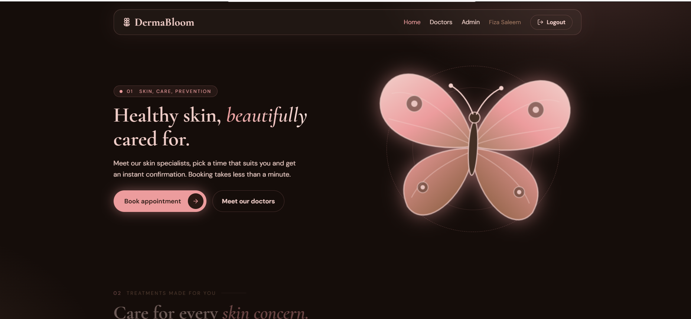
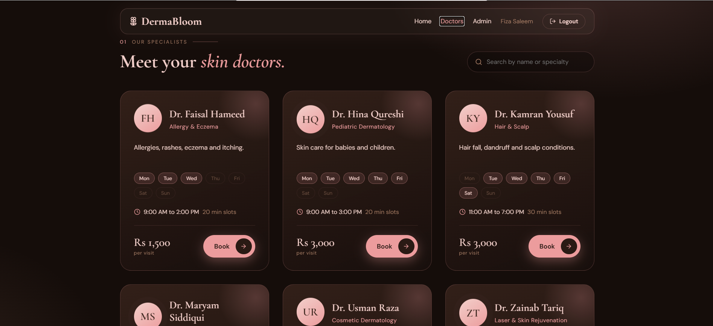
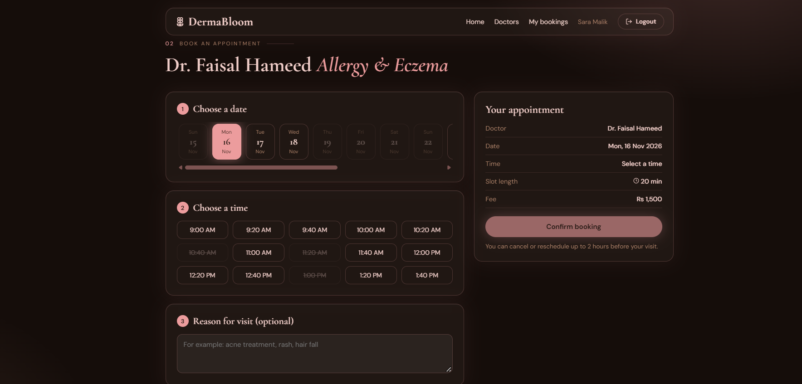
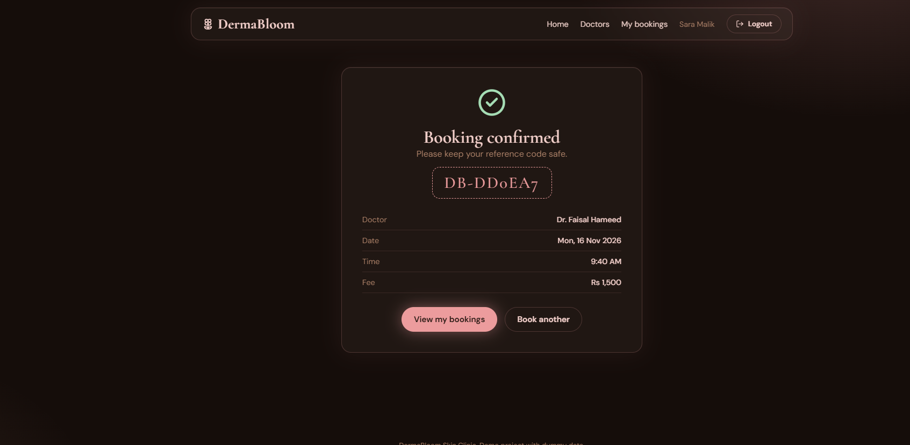
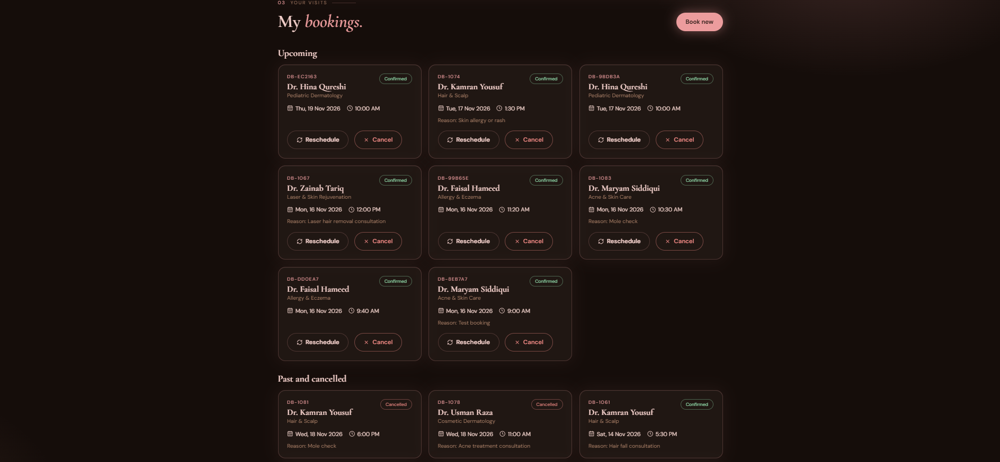
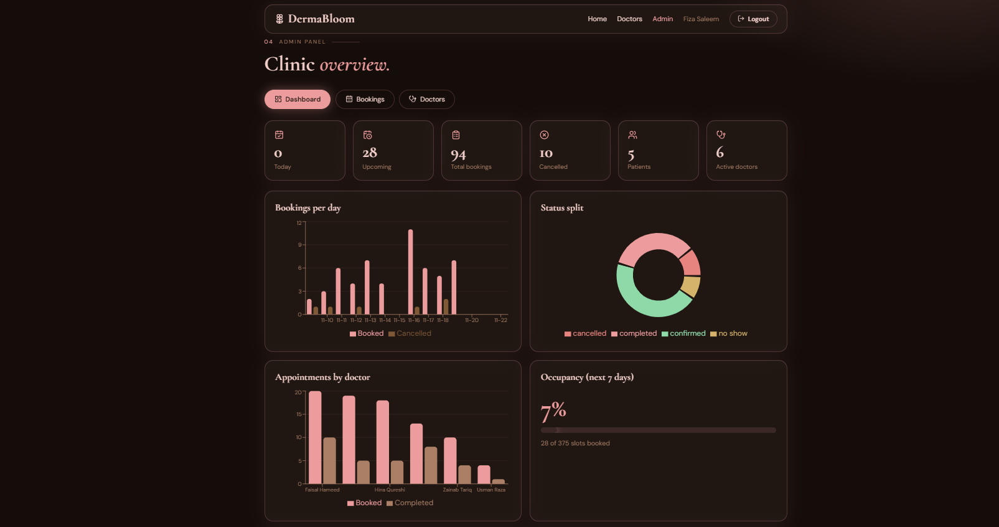
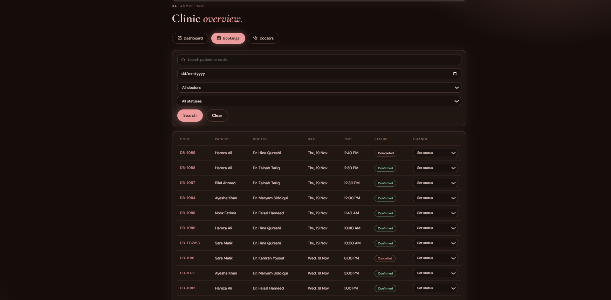
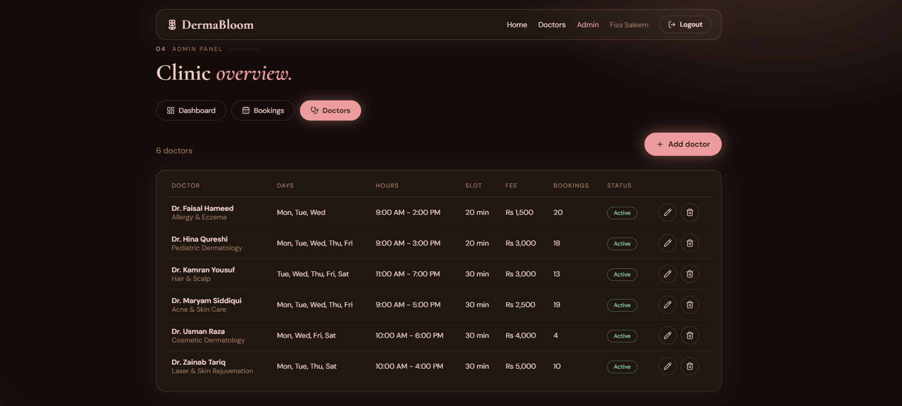

# DermaBloom: Skin Clinic Appointment Booking System

Codneura Internship, Project 4 (Booking System)

**Author:** Fiza Saleem
**Email:** fiza.cm26.9214@gmail.com

DermaBloom is a full stack appointment booking website for a dermatology clinic. Patients can find a doctor, pick a date and an available time slot, and manage their bookings. Clinic staff get an admin panel with reports, booking management and doctor management. All data in this project is dummy data.

## Features

**Patients**
- Register and log in (passwords are hashed, login uses a JWT token)
- Browse doctors with their specialty, working days, hours and fee
- Pick a date and see live time slots (booked and past slots are disabled)
- Double booking is prevented, even if two people try the same slot at the same moment
- Instant on-screen confirmation with a reference code (for example DB-1083)
- My Bookings page with upcoming and past visits
- Cancel or reschedule a booking (allowed until 2 hours before the visit)

**Admin / staff**
- Dashboard with today's bookings, upcoming visits, totals, cancellations, patients and active doctors
- Charts: bookings per day, status split, appointments per doctor, occupancy for the next 7 days
- Today's appointments list
- Bookings table with filters (date, doctor, status, search) and pagination
- Change booking status (confirmed, completed, cancelled, no show)
- Add, edit and remove doctors, set working days, hours, break time and slot length

## Tech Stack

- **Frontend:** React 18, Vite, React Router, Recharts, Lucide icons, plain CSS (glass style theme with animations)
- **Backend:** Node.js, Express 5, JSON Web Tokens, bcryptjs
- **Database:** SQLite (better-sqlite3)

## Setup

Requirements: Node.js 22 or newer, and npm.

**1. Backend** (runs on http://localhost:5001)

    cd backend
    copy .env.example .env
    npm install
    node seed.js
    node server.js

**2. Frontend** (open a second terminal, runs on http://localhost:5174)

    cd frontend
    npm install
    npm run dev

Then open http://localhost:5174 in your browser.

`node seed.js` creates the database file with dummy doctors, patients and about 90 bookings. To start again with fresh data, delete `backend/dermabloom.db` and run the seed command again.

## Demo Accounts

| Role | Email | Password |
|------|-------|----------|
| Admin | admin@dermabloom.test | Admin@123 |
| Patient | patient@dermabloom.test | Patient@123 |

The login page also has quick demo buttons for both accounts.

## Database

SQLite database with three tables:

- **users**: id, name, email (unique), phone, password_hash, role (patient or admin)
- **doctors**: id, name, specialty, bio, fee, work_days, start_time, end_time, slot_minutes, break_start, break_end, active
- **bookings**: id, ref_code (unique), patient_id, doctor_id, booking_date, slot_time, status (confirmed, completed, cancelled, no_show), reason

Double booking is blocked by the database itself with a partial unique index, so even two requests at the same moment cannot take the same slot:

    CREATE UNIQUE INDEX idx_no_double_booking
    ON bookings (doctor_id, booking_date, slot_time)
    WHERE status != 'cancelled';

SQL files are in the `database` folder:

- `database/schema.sql`: table definitions and indexes
- `database/seed.sql`: dummy data (users, doctors, bookings)

To rebuild the SQL files from the current database run `node export-sql.js` inside the `backend` folder.

## API Overview

| Area | Endpoints |
|------|-----------|
| Auth | POST /api/auth/register, POST /api/auth/login, GET /api/auth/me |
| Doctors | GET /api/doctors, GET /api/doctors/:id, GET /api/doctors/:id/slots?date=YYYY-MM-DD |
| Bookings (logged in) | POST /api/bookings, GET /api/bookings/mine, PUT /api/bookings/:id/cancel, PUT /api/bookings/:id/reschedule |
| Admin only | GET /api/admin/bookings, PUT /api/admin/bookings/:id/status, GET/POST/PUT/DELETE /api/admin/doctors, GET /api/admin/reports |

## Project Structure

    backend/    Express API, routes, auth middleware, seed and export scripts
    frontend/   React app (pages, components, styles)
    database/   schema.sql and seed.sql
    screenshots/  images used in this README

## Screenshots

**Home**

**Doctors**

**Choose a date and time**

**Booking confirmed**

**My bookings**

**Admin dashboard**

**Admin bookings**

**Admin doctors**

## Credits

- No stock photos are used. The butterfly and all illustrations are my own SVG drawings.
- Fonts: Cormorant Garamond and DM Sans from Google Fonts (SIL Open Font License)
- Icons: Lucide (ISC license)
- Charts: Recharts (MIT license)
- Colour palette: Dark Chocolate, Aloewood, Milk Tea, Sakura and Misty Rose

## Development Notes

I built this project while learning full stack development. I used an AI assistant (Claude by Anthropic) as a coding guide and pair programmer. I ran, tested and understood the code, and all names, accounts and records in the project are dummy data.
## Database

SQLite database with three tables:

- **users**: id, name, email (unique), phone, password_hash, role (patient or admin)
- **doctors**: id, name, specialty, bio, fee, work_days, start_time, end_time, slot_minutes, break_start, break_end, active
- **bookings**: id, ref_code (unique), patient_id, doctor_id, booking_date, slot_time, status (confirmed, completed, cancelled, no_show), reason

Double booking is blocked by the database itself with a partial unique index, so even two requests at the same moment cannot take the same slot:

    CREATE UNIQUE INDEX idx_no_double_booking
    ON bookings (doctor_id, booking_date, slot_time)
    WHERE status != 'cancelled';

SQL files are in the `database` folder:

- `database/schema.sql`: table definitions and indexes
- `database/seed.sql`: dummy data (users, doctors, bookings)

To rebuild the SQL files from the current database run `node export-sql.js` inside the `backend` folder.

## API Overview

| Area | Endpoints |
|------|-----------|
| Auth | POST /api/auth/register, POST /api/auth/login, GET /api/auth/me |
| Doctors | GET /api/doctors, GET /api/doctors/:id, GET /api/doctors/:id/slots?date=YYYY-MM-DD |
| Bookings (logged in) | POST /api/bookings, GET /api/bookings/mine, PUT /api/bookings/:id/cancel, PUT /api/bookings/:id/reschedule |
| Admin only | GET /api/admin/bookings, PUT /api/admin/bookings/:id/status, GET/POST/PUT/DELETE /api/admin/doctors, GET /api/admin/reports |

## Project Structure

    backend/    Express API, routes, auth middleware, seed and export scripts
    frontend/   React app (pages, components, styles)
    database/   schema.sql and seed.sql
    screenshots/  images used in this README

## Screenshots

**Home**

**Doctors**

**Choose a date and time**

**Booking confirmed**

**My bookings**

**Admin dashboard**

**Admin bookings**

**Admin doctors**

## Credits

- No stock photos are used. The butterfly and all illustrations are my own SVG drawings.
- Fonts: Cormorant Garamond and DM Sans from Google Fonts (SIL Open Font License)
- Icons: Lucide (ISC license)
- Charts: Recharts (MIT license)
- Colour palette: Dark Chocolate, Aloewood, Milk Tea, Sakura and Misty Rose

## Development Notes

I built this project while learning full stack development. I used an AI assistant (Claude by Anthropic) as a coding guide and pair programmer. I ran, tested and understood the code, and all names, accounts and records in the project are dummy data.
